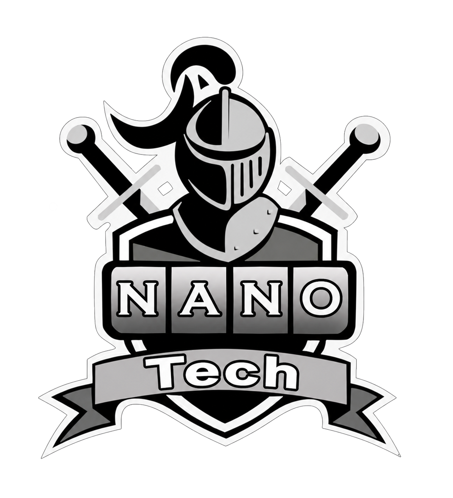
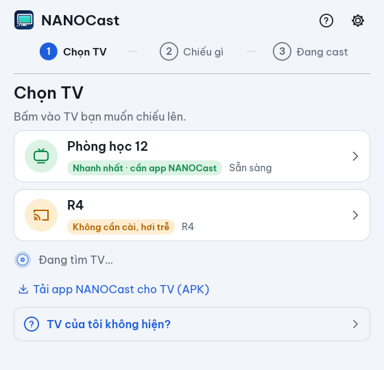
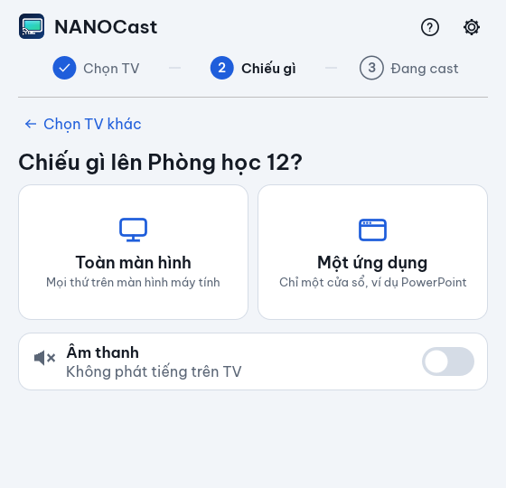
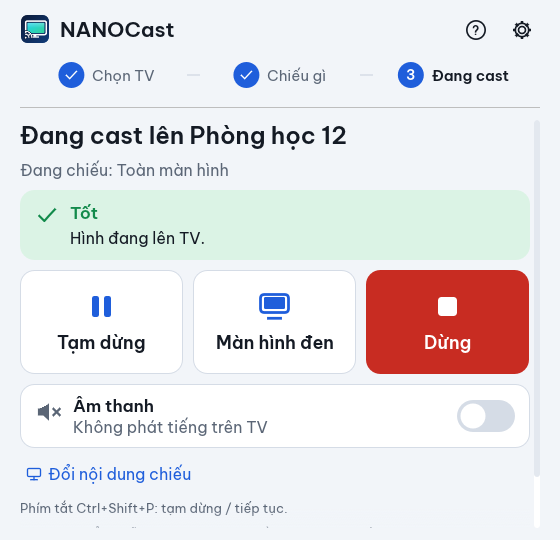
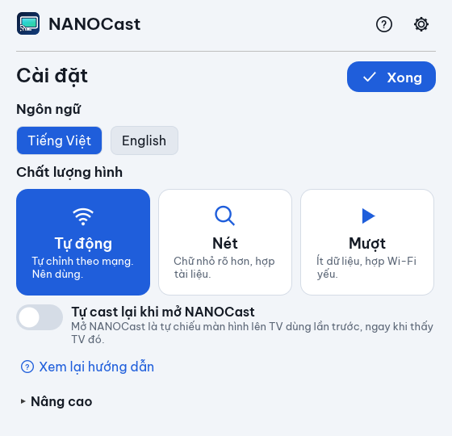

<p align="center">
  
</p>

<h1 align="center">NANOCast</h1>

<p align="center">
  <b>Chiếu màn hình máy tính lên TV cùng mạng Wi-Fi/LAN, gần như không trễ, không cần tài khoản, hoàn toàn miễn phí.</b><br>
  Làm cho giáo viên và lớp học: khi dây HDMI hỏng, mở app lên là chiếu được.
</p>

<p align="center">
  <a href="https://github.com/congluuit/NANOCast/actions/workflows/ci.yml"></a>
  <a href="https://github.com/congluuit/NANOCast/releases/latest"></a>
  
  
  
  
</p>

---

## Mục lục

- [NANOCast là gì](#nanocast-là-gì)
- [Tính năng](#tính-năng)
- [Hai cách chiếu lên TV](#hai-cách-chiếu-lên-tv)
- [Độ trễ thực tế](#độ-trễ-thực-tế)
- [Tải về / Cài đặt](#tải-về--cài-đặt)
  - [Windows](#windows)
  - [Cài trên Mac](#cài-trên-mac)
  - [Cài receiver lên TV](#cài-receiver-lên-tv)
- [Cách dùng](#cách-dùng)
- [Receiver desktop (PC cũ / Raspberry Pi cắm HDMI)](#receiver-desktop-pc-cũ--mini-pc--raspberry-pi-cắm-hdmi-vào-tv-máy-chiếu)
- [Cách hoạt động](#cách-hoạt-động)
- [Build từ mã nguồn](#build-từ-mã-nguồn)
- [Cấu trúc mã nguồn](#cấu-trúc-mã-nguồn)
- [Lộ trình và tình trạng](#lộ-trình-và-tình-trạng)
- [Đóng góp](#đóng-góp)
- [Ủng hộ dự án](#ủng-hộ-dự-án)
- [Giấy phép](#giấy-phép)

## NANOCast là gì

NANOCast gồm hai phần:

- **App trên máy tính** (`nanocast.exe` trên Windows, `NANOCast.app` trên Mac): quét TV trong mạng, bấm một nút là chiếu **toàn màn hình** hoặc **đúng một ứng dụng** (PowerPoint, Chrome…) lên TV, kèm hoặc không kèm âm thanh.
- **App trên TV** (*NANOCast Receiver* cho Android TV / Google TV / box Android, hoặc `nanocast-receiver` cho PC cũ cắm HDMI): nhận hình và hiển thị ngay, không buffer.

Khác với Chromecast / Miracast có sẵn, NANOCast dùng **bộ mã hoá phần cứng** của máy tính (Intel Quick Sync, NVIDIA, AMD, Apple VideoToolbox), gửi **Full HD 60 fps** qua UDP không đệm, nên độ trễ tổng chỉ vài chục mili giây và máy yếu vẫn chạy nhẹ (CPU ~13 % một lõi khi chiếu 1080p60, ~2 % khi màn hình đứng yên).

Không tài khoản, không internet, không thu thập dữ liệu, không quảng cáo. Mọi thứ chạy trong mạng nội bộ của bạn.

## Tính năng

| | |
|---|---|
| **Chiếu toàn màn hình hoặc một ứng dụng** | Chọn cửa sổ nào thì chỉ cửa sổ đó lên TV, kể cả khi bị che bởi cửa sổ khác. |
| **Full HD 60 fps, bitrate thích nghi** | 10–30 Mbps; mạng yếu thì tự hạ chất lượng, ổn định lại thì tự tăng. |
| **Âm thanh** | Bật/tắt ngay trong lúc chiếu; tiếng của máy tính (YouTube, PowerPoint) ra loa TV. |
| **Tạm dừng / Màn hình đen** | TV giữ hình hoặc tối đen khi giáo viên làm việc riêng; phím tắt **Ctrl+Shift+P**. |
| **Mã 4 số** | Tuỳ chọn trên TV, tránh học sinh chiếu đè. |
| **Chromecast có sẵn trong TV** | Không cài gì trên TV cũng chiếu được (trễ hơn), xem [bên dưới](#hai-cách-chiếu-lên-tv). |
| **Nhớ TV, tự chiếu lại** | Mở app là chiếu ngay lên TV lần trước (tuỳ chọn). |
| **Dễ dùng cho người không rành kỹ thuật** | 3 bước, chữ to, lỗi nói bằng tiếng người kèm cách sửa, hướng dẫn lần đầu, tiếng Việt / English. |
| **Nhẹ** | Một file `.exe` ~8 MB, không cần quyền admin, không cài driver, không service nền. |
| **Receiver cho TV thường** | PC cũ / mini PC / Raspberry Pi cắm HDMI vào TV hay máy chiếu chạy `nanocast-receiver`. |

## Hai cách chiếu lên TV

| | **Nhanh nhất · cần app NANOCast trên TV** | **Không cần cài, hơi trễ · Chromecast có sẵn** |
|---|---|---|
| TV cần gì | Cài APK *NANOCast Receiver* một lần (Android TV, Google TV, box Android, Fire TV) hoặc PC/Pi cắm HDMI chạy `nanocast-receiver` | Chỉ cần TV có Chromecast built-in / Google TV |
| Độ trễ | **~30–50 ms** (Ethernet, TV ở Game Mode) | ~0,1–0,4 s (mirroring), ~1–3 s (dự phòng) |
| Chất lượng | 1080p60, 10–30 Mbps, H.264 hoặc HEVC | 1080p60 H.264, 12 Mbps |
| Tạm dừng / màn đen / mã số | Có | Không |
| Dùng khi | Lớp học dùng thường xuyên | Khẩn cấp, TV lạ, không cài được gì |

Cả hai loại hiện chung trong danh sách TV của app với nhãn tương ứng, bấm là chiếu.

## Độ trễ thực tế

Số đo trên laptop Intel i9-13900HX + Intel UHD (Quick Sync) và emulator Android TV, chi tiết trong [docs/benchmark.md](docs/benchmark.md):

| Khâu | Thời gian |
|---|---|
| Capture + chuyển màu trên GPU | < 1 ms |
| Mã hoá H.264 phần cứng | 6–13 ms |
| Mạng LAN | 1–3 ms (Ethernet) / 5–25 ms (Wi-Fi) |
| Giải mã trên TV | 4–11 ms |
| TV hiển thị (Game Mode) | 10–20 ms |
| **Tổng ước tính** | **~30–50 ms** |

Chromecast mirroring của Chrome: 300 ms đến hơn 1 s. HDMI: 0 ms. Qua mạng không thể bằng HDMI, nhưng ở mức này mắt không phân biệt được khi lướt web, trình chiếu, xem video. Để đạt số này: cắm dây mạng cho TV (hoặc Wi-Fi 5 GHz cùng phòng) và bật **Game Mode** trên TV. Hướng dẫn từng hãng: [docs/tv-setup.md](docs/tv-setup.md).

> Số glass-to-glass trên TV thật chưa được đo; nếu bạn đo được (quay slow-motion hai màn hình), xin gửi vào Issues.

## Tải về / Cài đặt

Mọi bản phát hành ở [GitHub Releases](https://github.com/congluuit/NANOCast/releases/latest):

| File | Dùng khi |
|---|---|
| `NANOCast-Setup-<version>.exe` | **Windows**, cài bình thường (tiếng Việt / English). Mặc định cài cho riêng người dùng hiện tại vào `%LOCALAPPDATA%\Programs\NANOCast`, **không cần quyền admin**; chọn "cho mọi người dùng" thì cài vào Program Files (cần admin). Có shortcut Start Menu, tuỳ chọn Desktop, gỡ trong *Settings → Apps*. |
| `NANOCast-<version>-portable-win64.zip` | Windows, không muốn cài: giải nén, chạy `nanocast.exe` (chép USB mang theo được). |
| `NANOCast-<version>-portable-win64.exe` | Chính `nanocast.exe` của bản portable, không nén (bản portable tự cập nhật bằng file này). |
| `NANOCast-Receiver-<version>-androidtv.apk` | Cài lên TV / box Android. |
| `NANOCast-<version>-macos-universal.dmg` | Mac Intel và Apple Silicon, macOS 12.3+. |

**Tự cập nhật**: vài giờ một lần, app trên máy tính và app trên TV tự xem GitHub Releases có bản mới không.
- **Windows**: tự tải bản mới về; bấm **Cập nhật** trên thông báo (app đóng, cài, tự mở lại) hoặc để đó, bản mới tự cài khi tắt NANOCast. Bản cài "cho mọi người dùng" (Program Files) cần bấm Cập nhật vì phải hỏi quyền admin. Tắt / kiểm tra ngay trong *Cài đặt → Cập nhật*.
- **macOS**: báo có bản mới và mở trang tải `.dmg`.
- **TV**: tự tải APK mới; lúc không có máy nào đang cast, TV hiện hộp thoại *Cài đặt* của Android (Android 12+ từ lần thứ hai thì cài luôn không hỏi). Bỏ qua thì bấm **▲** trên điều khiển để cài sau. TV đang chạy bản cũ ký khoá khác (ví dụ 0.1.0) phải cài lại một lần bằng **Cài app lên TV** trên máy tính.

### Windows

Chạy `NANOCast-Setup-<version>.exe` hoặc giải nén bản portable. Lần đầu Windows Firewall hỏi, chọn **Allow** trên mạng *Private* để app tìm được TV. Cài im lặng cho cả phòng máy: `NANOCast-Setup-<version>.exe /VERYSILENT /TASKS=desktopicon`.

### Cài trên Mac

> Bản Mac được viết và kiểm tra biên dịch nhưng **chưa chạy thử trên Mac thật**; nếu gặp lỗi, xin mở issue kèm phiên bản macOS và loại máy (Intel / Apple Silicon).

Cần macOS 12.3 trở lên.

1. Tải `.dmg`, mở ra, kéo **NANOCast** vào **Applications**.
2. Mở lần đầu: app chưa ký Developer ID nên macOS chặn. **Chuột phải** vào NANOCast > **Open** > **Open** (chỉ một lần). macOS 15 trở lên: mở thử một lần rồi vào *System Settings > Privacy & Security* bấm **Open Anyway**. Hoặc trong Terminal:
   ```bash
   xattr -dr com.apple.quarantine /Applications/NANOCast.app
   ```
3. Cấp quyền ghi màn hình: *System Settings > Privacy & Security > Screen Recording* (macOS 15: *Screen & System Audio Recording*), bật **NANOCast**, rồi **thoát hẳn (Cmd+Q) và mở lại**.
4. macOS 15+: khi được hỏi quyền mạng cục bộ (Local Network), chọn **Allow**.

Tự đóng gói `.dmg` trên Mac (cần `xcode-select --install` và [rustup](https://rustup.rs)): `bash installer/macos/build-mac.sh` → `installer/out/NANOCast-<version>-macos-universal.dmg` (thêm `--per-arch` để có bản riêng `-arm64` / `-x86_64`). Chi tiết: [docs/macos.md](docs/macos.md).

### Cài receiver lên TV

TV / box Android (Android TV, Google TV, Fire TV, box Android bất kỳ):

- **Từ app trên máy tính, qua Wi-Fi (không cần USB)**: TV có Chromecast hiện trong danh sách với nút **Cài app lên TV**; TV / box Android khác (Fire TV, box không có Chromecast, mạng chặn mDNS) thì bấm **Cài app lên TV qua Wi-Fi (gõ địa chỉ IP)** dưới danh sách và gõ IP của TV (Cài đặt → Mạng). Trên TV bật *Tuỳ chọn cho nhà phát triển* (Cài đặt → Giới thiệu → bấm *Bản dựng* 7 lần) rồi bật **Gỡ lỗi USB**; bấm *Bắt đầu cài*, trên TV chọn **Cho phép**. App tự tải đúng APK của phiên bản, cài, mở app trên TV rồi **tắt gỡ lỗi** lại. TV Android 11+ chỉ bật *Gỡ lỗi không dây* thì app hỏi mã ghép nối 6 số (Tuỳ chọn cho nhà phát triển → Gỡ lỗi không dây → *Ghép nối thiết bị bằng mã ghép nối*) rồi cài tiếp như trên.
- **Không cần máy tính**: trên TV cài app *Downloader* (hoặc trình duyệt), tải file `NANOCast-Receiver-<version>-androidtv.apk` từ [Releases](https://github.com/congluuit/NANOCast/releases/latest), mở file để cài (bật *Cho phép nguồn không xác định* khi TV hỏi). Hoặc chép APK vào USB, mở bằng trình quản lý file trên TV.
- **Bằng adb từ máy tính**: bật *Developer options → Network debugging* trên TV, rồi:
  ```bash
  adb connect <ip-tv>:5555
  adb install -r NANOCast-Receiver-<version>-androidtv.apk
  ```

Mở app *NANOCast* trên TV; góc trái hiện IP của TV. Bật **Game Mode** trên TV để giảm trễ. Hướng dẫn đầy đủ từng hãng TV, mẹo mạng, cách đo độ trễ: [docs/tv-setup.md](docs/tv-setup.md). Đăng lên Google Play: [docs/play-store.md](docs/play-store.md).

**Mã 4 số (tuỳ chọn, mặc định tắt)**: bấm **OK** trên điều khiển TV để bật/tắt. Khi bật, góc dưới phải hiện `Mã / Code 1234`; máy tính phải nhập đúng mã mới chiếu được, và TV chỉ nhận hình/tiếng từ đúng máy đó. Mã được nhớ qua các lần mở app; tắt rồi bật lại thì có mã mới.

TV không phải Android (Samsung Tizen, LG webOS, máy chiếu thường): dùng Chromecast có sẵn nếu TV có, hoặc cắm PC cũ / Raspberry Pi chạy [receiver desktop](#receiver-desktop-pc-cũ--mini-pc--raspberry-pi-cắm-hdmi-vào-tv-máy-chiếu), hoặc một box Android TV giá rẻ.

## Cách dùng

`nanocast.exe` dẫn từng bước, mỗi màn hình một việc; chữ to, không thuật ngữ. Lần đầu mở có **hướng dẫn 3 trang** (bấm **Bỏ qua** nếu đã quen; xem lại bằng nút **?** góc trên).

| 1. Chọn TV | 2. Chiếu gì | 3. Đang cast |
|---|---|---|
|  |  |  |

1. **Chọn TV.** TV và máy tính cùng mạng Wi-Fi/LAN; mở app NANOCast trên TV. TV tự hiện thành thẻ (app luôn tìm, không cần bấm gì):
   - **Nhanh nhất · cần app NANOCast**: TV / box Android hoặc PC đang chạy app NANOCast. Nút **Tải app NANOCast cho TV (APK)** ngay dưới danh sách tải đúng file của phiên bản đang dùng.
   - **Không cần cài, hơi trễ**: TV có sẵn Chromecast (Google TV, Android TV, Chromecast). Loa Google Home / Nest không hiện.
   - Không thấy TV? Bấm **TV của tôi không hiện?**: 3 điều cần kiểm tra và ô gõ địa chỉ IP đang hiện trên TV (mạng trường hay chặn việc tự tìm).
2. **Chiếu gì.** Hai nút lớn: **Toàn màn hình** (nhiều màn hình thì chọn ở ô *Màn hình*) hoặc **Một ứng dụng** (danh sách cửa sổ đang mở với tên dễ hiểu; cửa sổ hệ thống đã được lọc). Chỉ cửa sổ đó lên TV, kể cả khi bị che; menu bật ra là cửa sổ riêng nên không hiện, cần thấy menu thì chọn Toàn màn hình. Công tắc **Âm thanh** (mặc định tắt) gửi tiếng của máy tính ra loa TV.
   TV đang bật **mã 4 số** (thẻ có ổ khoá): app hỏi mã bằng một ô số lớn; nhập một lần, app nhớ cho lần sau.
3. **Đang cast lên &lt;TV&gt;.** Thanh trạng thái bằng lời: *Tốt* / *Mạng yếu, đang giảm chất lượng* / *Mất kết nối* / *Đang tạm dừng* / *Màn hình đen*. Ba nút lớn:
   - **Tạm dừng**: TV giữ hình đang hiện, máy tính ngừng gửi hình và tiếng; **Tiếp tục** để chiếu lại. Phím tắt toàn cục **Ctrl+Shift+P**.
   - **Màn hình đen**: TV tô đen; **Hiện lại** để chiếu tiếp.
   - **Dừng**: ngừng cast, quay về bước 2.

   **Đổi nội dung chiếu** quay về bước 2 mà không dừng; công tắc Âm thanh đổi được ngay. Số liệu kỹ thuật (fps, Mbps, encode/decode ms, gói mất, bitrate và lý do, bộ mã hoá) nằm trong **Chi tiết**.

**Khi có sự cố**, app nói bằng lời kèm cách sửa, mã lỗi kỹ thuật chỉ nằm trong *Chi tiết*:
- Mất kết nối với TV: *Mất kết nối, tự thử lại sau 10 giây*, có nút **Thử lại ngay**; TV quay lại là tự chiếu tiếp. Thử 6 lần không được thì dừng và ghi các bước kiểm tra.
- Gõ IP sai: *Địa chỉ chưa đúng. Ví dụ: 192.168.1.20*. Mã sai: *Mã chưa đúng, hãy xem lại trên TV*.
- Không mã hoá / không lấy được hình: nói rõ và gợi ý đổi Bộ mã hoá hoặc chọn Toàn màn hình.

**Khay hệ thống (Windows)**: đóng cửa sổ khi đang cast thì app thu xuống khay (góc dưới phải), vẫn cast. Bấm đúp biểu tượng để mở lại; chuột phải: **Mở NANOCast**, **Tạm dừng / Tiếp tục**, **Dừng cast**, **Thoát**. Không cast thì đóng cửa sổ là thoát.

**Cài đặt** (nút bánh răng; lưu tự động trong `%APPDATA%\NANOCast\config.json`):



- **Ngôn ngữ**: Tiếng Việt (mặc định) / English.
- **Chất lượng hình**: **Tự động** (20 Mbps, 60 fps, tự chỉnh theo mạng; nên dùng), **Nét** (30 Mbps, 30 fps: chữ nhỏ rõ hơn), **Mượt** (10 Mbps, 60 fps: hợp Wi-Fi yếu).
- **Tự cast lại khi mở NANOCast**: mở app là chiếu lên TV dùng lần trước ngay khi thấy TV đó.
- **Nâng cao**: Codec H.264 (mặc định) hoặc HEVC (nhẹ mạng hơn, chỉ khi TV giải mã được); Bộ mã hoá phần cứng; Bitrate 10/20/30 Mbps + Tự chỉnh theo mạng; Khung hình 30/60 fps; Xử lý hình (Windows) Tự động / Card đồ hoạ / CPU; Bỏ qua khung hình không đổi.

Giao diện sáng/tối theo hệ thống (`NANOCAST_THEME=light|dark` để ép). Chữ dùng font **Be Vietnam Pro** nhúng sẵn (đủ dấu tiếng Việt, giấy phép SIL OFL 1.1, [assets/fonts/OFL.txt](assets/fonts/OFL.txt)).

Hạn chế hiện tại: âm thanh lấy từ thiết bị phát mặc định của Windows (đổi thiết bị khi đang cast thì tắt rồi bật lại **Âm thanh**); cần encoder phần cứng (Intel Quick Sync, NVIDIA, AMD) qua Media Foundation, máy không có thì không chiếu được; nội dung có DRM (Netflix…) sẽ đen; Windows 10 luôn có viền vàng quanh vùng đang cast; Chromecast không có Tạm dừng / Màn hình đen.

Thử không cần TV: chạy `nanocast-receiver --windowed` trên cùng máy, nó hiện trong danh sách như một TV.

## Receiver desktop (PC cũ / mini PC / Raspberry Pi cắm HDMI vào TV, máy chiếu)

TV không phải Android (Samsung, LG, máy chiếu thường): cắm một PC cũ / mini PC / Raspberry Pi vào cổng HDMI và chạy `nanocast-receiver`. Nó quảng bá mình qua mDNS (tên = tên máy) nên hiện trong danh sách của `nanocast.exe` như một TV, nhận hình + tiếng và chiếu toàn màn hình.

```bash
cargo build --release -p nanocast-receiver
target/release/nanocast-receiver
```

- Màn hình chờ hiện tên máy và IP (để gõ tay vào `nanocast.exe` khi mạng chặn mDNS).
- Phím: **O** bật/tắt số liệu, **F**/**F11** full screen, **Esc** thoát.
- Tuỳ chọn: `--name "Phong 12"`, `--windowed`, `--on-top`, `--overlay`, `--no-audio`, `--no-mdns`, `--max 1920x1080`, `--pin` (mã 4 số ngẫu nhiên) hoặc `--pin-code 1234`, `--exit-after <giây>`. Log: `RUST_LOG=debug`. Backend GPU: `WGPU_BACKEND=dx12|vulkan|gl`.
- Tạm dừng, màn hình đen và mã 4 số hoạt động như receiver Android. **Chỉ giải mã H.264** (không HEVC): `nanocast.exe` tự gửi H.264 cho receiver này.
- Cổng cần mở trên firewall: UDP 48322 (hình), UDP 48324 (tiếng), TCP 48323 (control), UDP 5353 (mDNS).
- Decode hiện là **OpenH264 phần mềm** (1080p60 ~4 ms/khung trên i9; máy yếu để sender ở 30 fps). Có [NASM](https://www.nasm.us/) trong PATH lúc build thì nhanh hơn. Decoder phần cứng chưa làm.

### Raspberry Pi / Linux (chưa kiểm chứng)

- Raspberry Pi 4 / 5, Raspberry Pi OS 64-bit (Bookworm) bản Desktop; cần phiên đồ hoạ X11/Wayland.
- Gói build và runtime:
  ```bash
  sudo apt install build-essential pkg-config libasound2-dev libxkbcommon-x11-0 libwayland-client0 mesa-vulkan-drivers
  curl --proto '=https' --tlsv1.2 -sSf https://sh.rustup.rs | sh
  cargo build --release -p nanocast-receiver
  ```
- Chạy `./target/release/nanocast-receiver --name "Phong 12"` (thử `WGPU_BACKEND=gl` nếu Vulkan lỗi). Tự chạy khi đăng nhập: `~/.config/autostart/nanocast-receiver.desktop`. Pi 4 nên để sender 30 fps.

## Cách hoạt động

```
Máy tính (nanocast)                                     TV
+---------------------------------------------+        +------------------------------+
| Capture: Windows Graphics Capture /         |  mDNS  | NANOCast Receiver            |
|   ScreenCaptureKit / PipeWire               | <----- |  Android TV / PC / Pi        |
|   (màn hình hoặc 1 cửa sổ, giữ trên GPU)    |        |                              |
|        | chuyển NV12 trên GPU               |  UDP   |  ráp gói -> MediaCodec /     |
| Encode: Media Foundation (QSV/NVENC/AMF),   | video  |  OpenH264 -> hiển thị ngay   |
|   VideoToolbox, VA-API; H.264/HEVC,         | -----> |  Opus -> loa                 |
|   không B-frame, CBR, keyframe theo yêu cầu |  UDP   |                              |
| Âm thanh: WASAPI loopback -> Opus 20 ms     | audio  |  Tạm dừng / đen / mã 4 số    |
| Gói UDP rải đều (không tràn buffer TV)      | -----> |                              |
| Kênh control TCP JSON: hello, start, stop,  |  TCP   |  caps, keyframe_request,     |
|   audio, pause, blank, pin                  | <----> |  stats mỗi giây              |
+---------------------------------------------+        +------------------------------+
         |  hoặc: Google Cast v2 (TLS 8009) -> Chromecast có sẵn trong TV
```

Giao thức cố ý tối giản: header video 14 byte (`magic | seq | frame_id | idx | count`), một khung = một access unit H.264 Annex B chia thành các gói ≤ 1200 byte; mất gói thì TV xin keyframe qua kênh control thay vì chờ. Bitrate thích nghi dựa trên thống kê TV gửi về. Chi tiết trong [PLAN.md](PLAN.md) mục 4 và [docs/benchmark.md](docs/benchmark.md).

## Build từ mã nguồn

Cần [Rust](https://rustup.rs) stable. Trên Windows dùng toolchain MSVC.

```bash
cargo build --release
```

Kết quả trong `target/release/`: `nanocast.exe` (app), `nanocast-receiver.exe` (receiver desktop), `spike-win.exe` / `spike-send.exe` (công cụ đo). Chạy test: `cargo test --release`.

Đóng gói Windows (cần [Inno Setup 6](https://jrsoftware.org/isinfo.php): `winget install JRSoftware.InnoSetup`):

```bash
ISCC.exe installer\nanocast.iss
powershell -ExecutionPolicy Bypass -File installer\make-portable.ps1 -NoBuild
```

Receiver Android TV (cần Android SDK, JDK 17):

```bash
cd receiver-androidtv
gradlew.bat assembleDebug
```

Sender Linux (chưa kiểm chứng): `crates/linux-capture` chụp qua xdg-desktop-portal + PipeWire hoặc X11, mã hoá bằng FFmpeg (VA-API / NVENC / V4L2 M2M / x264) hoặc OpenH264; gói cần cài và cách chạy trong [docs/linux.md](docs/linux.md).

Phát hành: tăng `version` trong `Cargo.toml` (APK cũng lấy số này), push tag `v<version>`; workflow `release.yml` tự build installer, zip + exe portable, APK, `.dmg` macOS và tạo GitHub Release. APK được ký bằng keystore trong secrets của repo để TV cập nhật đè được: xem [docs/play-store.md](docs/play-store.md#ký-apk-trên-github-để-tv-tự-cập-nhật).

## Cấu trúc mã nguồn

| Thư mục | Nội dung |
|---|---|
| `crates/app` | `nanocast.exe`: GUI egui 3 bước, Chromecast, khay hệ thống, chuỗi VI/EN, cài app lên TV qua ADB Wi-Fi (`adb.rs`, `tv_install.rs`) |
| `crates/core` | Giao thức, discovery mDNS, kênh control, bitrate thích nghi, Opus |
| `crates/win-capture` | `nanocast-win`: capture WGC → NV12 trên GPU → Media Foundation H.264/HEVC → UDP, âm thanh WASAPI |
| `crates/mac-capture` | `nanocast-mac`: ScreenCaptureKit → VideoToolbox, cùng API (chưa kiểm chứng) |
| `crates/linux-capture` | `nanocast-linux`: portal/PipeWire hoặc X11 → FFmpeg/OpenH264 (chưa kiểm chứng) |
| `crates/cast-google` | `nanocast-cast`: Google Cast v2, mirroring và Default Media Receiver (fMP4 live) |
| `crates/receiver-desktop` | `nanocast-receiver`: receiver cho PC cũ / Pi (OpenH264 + wgpu + cpal) |
| `receiver-androidtv` | Receiver Android TV (Kotlin, không thư viện ngoài) |
| `crates/spike-win`, `crates/spike-send` | Công cụ đo/thử dòng lệnh |
| `tools/icongen`, `assets` | Icon vẽ tay (SVG) và render |
| `installer`, `.github/workflows` | Inno Setup, portable, `.dmg` macOS, CI và release |
| `docs` | Benchmark, hướng dẫn TV, macOS, Linux, Play Store, Google Cast |

## Lộ trình và tình trạng

Theo [PLAN.md](PLAN.md):

| Phase | Nội dung | Tình trạng |
|---|---|---|
| 1 | Windows sender + receiver Android TV, âm thanh, GPU zero-copy | Xong, đo trên emulator; chưa đo glass-to-glass trên TV thật |
| 2 | Receiver desktop, bitrate thích nghi, tạm dừng/màn đen, nhớ TV, mã 4 số, installer, VI/EN | Xong |
| 3 | macOS, Linux, HEVC | Code xong, Mac/Linux chưa chạy trên máy thật |
| 4 | Chromecast có sẵn trong TV | Kênh Cast thử trên Nest Mini; mirroring chưa thử trên TV |
| 5 | UI cho người không rành kỹ thuật | Xong |
| Tuỳ chọn | AV1, receiver webOS/Tizen qua WebRTC | Chưa làm |

Nếu bạn có TV thật và thử được, xin báo kết quả (hãng TV, mạng, cảm nhận độ trễ) trong Issues để dự án tốt hơn.

## Đóng góp

Issues và pull request đều được hoan nghênh. Trước khi gửi PR: `cargo fmt`, `cargo clippy`, `cargo test`. Code Rust theo kiến trúc trong [PLAN.md](PLAN.md); các platform mới chỉ cần implement cùng API với `nanocast-win`.

## Ủng hộ dự án

NANOCast miễn phí và sẽ luôn miễn phí cho giáo viên, trường học và mọi người. Nếu phần mềm giúp ích cho bạn, một ly cà phê sẽ giúp mình có thêm động lực duy trì và mua thiết bị để test (TV, box Android, Chromecast các đời).

<p align="center">
  <br>
  <b>LUU DUC THANH CONG</b> · BIDV · <code>6503695458</code><br>
  <sub>Quét mã VietQR bằng app ngân hàng bất kỳ.</sub>
</p>

## Giấy phép

Mã nguồn phát hành theo giấy phép **MIT hoặc Apache-2.0** (tuỳ bạn chọn). Font Be Vietnam Pro theo SIL OFL 1.1. OpenH264 theo giấy phép BSD của Cisco.

Một sản phẩm của **NANO Tech**, làm bởi Lưu Đức Thành Công.
